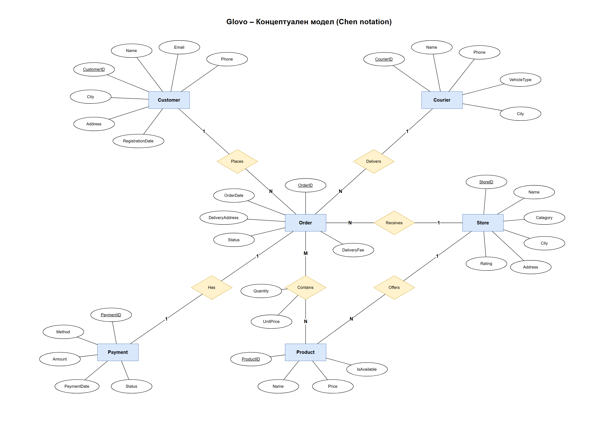
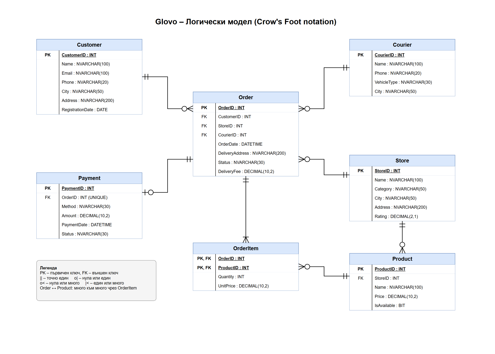
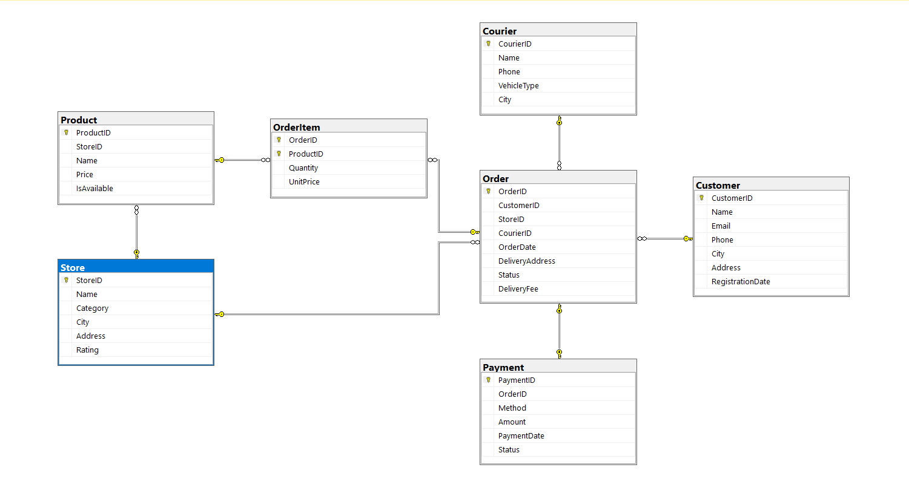
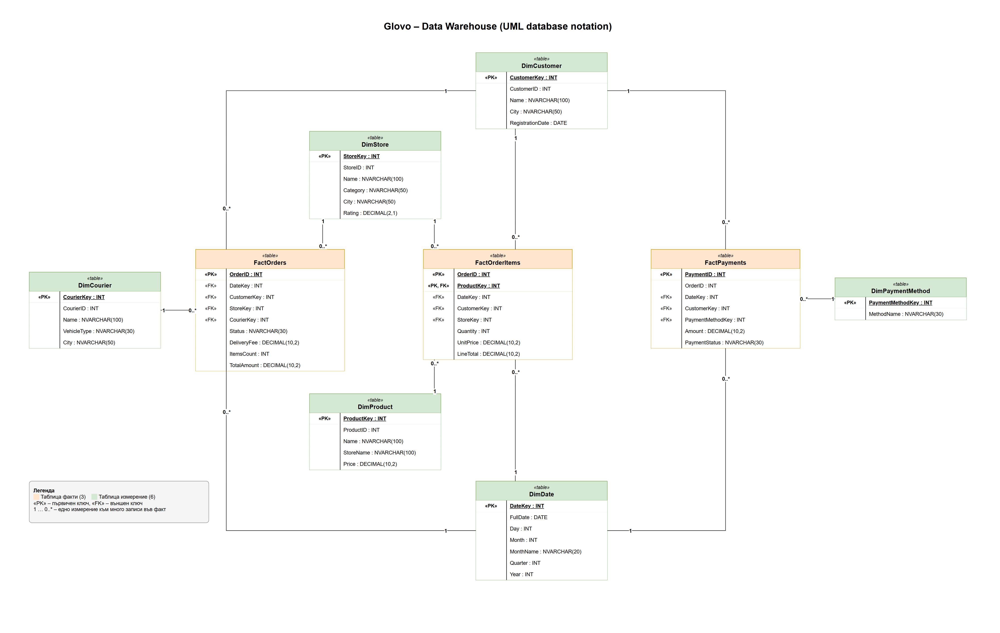
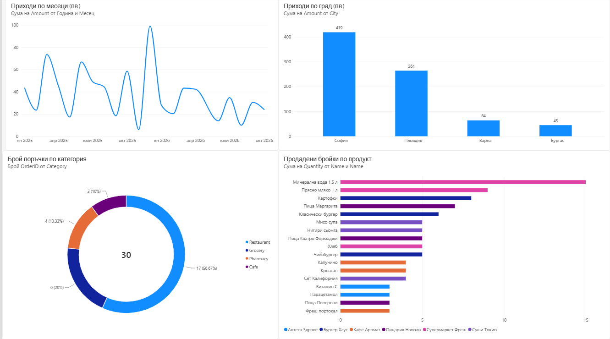

# Glovo – база данни за доставка на храна и стоки

*   **Студент:** Юсеин Мехмедов
*   **Факултетен номер:** 2401321052
*   **Проект:** Glovo

## Описание

Курсов проект по бази данни, вдъхновен от платформата Glovo. Клиенти поръчват продукти от обекти (ресторанти, магазини, аптеки, кафенета), а куриери доставят поръчките до адреса им.

Проектът съдържа:

*   концептуален модел (Chen) и логически модел (Crow's Foot);
*   база данни в MS SQL Server със 7 таблици, данни, функция, съхранена процедура и тригер;
*   модел на склад от данни (Data Warehouse) в UML нотация – 3 таблици с факти и 6 измерения;
*   отчет в Power BI с 4 визуализации.

## Снимки

### Концептуален модел (Chen)


### Логически модел (Crow's Foot)


### Диаграма на базата (SSMS)


### Модел на склад от данни (UML)


### Отчет в Power BI


## Файлове

| Файл | Съдържание |
| :--- | :--- |
| `conceptual-model.drawio` / `.png` | Концептуален модел (Chen) |
| `logical-model.drawio` / `.png` | Логически модел (Crow's Foot) |
| `database-diagram.png` | Диаграма на базата от SSMS |
| `GlovoDB.sql` | Скрипт на базата – таблици, данни, функция, процедура и тригер |
| `dw-model.drawio` / `.png` | Модел на склад от данни (UML) |
| `Glovo-Report.pbix` | Отчет в Power BI |
| `powerbi-report.png` | Снимка на отчета |

## Инсталация и стартиране

Нужни програми: **MS SQL Server** (напр. Express), **SQL Server Management Studio (SSMS)** и **Power BI Desktop**.

### 1. База данни

1.  Отворете SSMS и се свържете със сървъра.
2.  Създайте празна база с име **GlovoDB** (десен бутон върху *Databases* → *New Database...*) или с командата:
    ```sql
    CREATE DATABASE GlovoDB;
    ```
3.  Отворете файла `GlovoDB.sql` (*File* → *Open* → *File...*) и натиснете **Execute** (F5).
4.  Проверка:
    ```sql
    USE GlovoDB;
    SELECT dbo.fn_OrderTotal(1);          -- обща сума на поръчка 1
    EXEC dbo.usp_GetCustomerOrders 1;     -- поръчките на клиент 1
    ```

### 2. Отчет в Power BI

1.  Отворете `Glovo-Report.pbix` с Power BI Desktop.
2.  Ако името на вашия сървър е различно: *Transform data* → *Data source settings* → *Change Source...* и въведете своя сървър.
3.  Натиснете **Refresh**.

### 3. Диаграми

Файловете `.drawio` се отварят с [draw.io](https://app.diagrams.net). За бърз преглед има и `.png` снимки.
